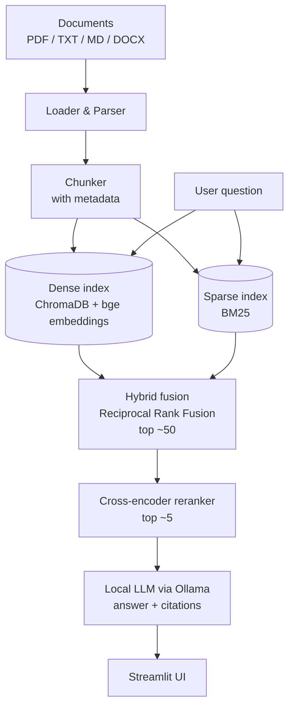

# Hybrid RAG via Reranking

A fully local, free-to-run **Retrieval-Augmented Generation (RAG)** system that combines **dense (semantic) search** and **sparse (BM25 keyword) search**, fuses the results with **Reciprocal Rank Fusion**, refines them with a **cross-encoder reranker**, and generates grounded, cited answers with a **local LLM via Ollama**.

It comes with a **Streamlit UI** that shows each step of the pipeline, and an **evaluation harness** that measures how much each stage contributes.

**Results in brief:** on two BEIR benchmarks, hybrid search beats dense search alone (nDCG@10 0.731 vs 0.717 on SciFact, 0.366 vs 0.348 on NFCorpus). The small CPU-friendly reranker did not improve on hybrid search further. See [Evaluation](#evaluation) for the numbers and what changed them.

> **Status:** All core features are implemented, tested and benchmarked. See the [Roadmap](#roadmap) for open experiments.

---

## Why hybrid + reranking?

| Approach | Good at | Weak at |
|---|---|---|
| **Dense search** (embeddings) | Matching *meaning*: "fix a flat tire" ≈ "repair a punctured wheel" | Exact terms, IDs, codes, rare names |
| **Sparse search** (BM25) | Exact keywords: `Error 0x80070005`, `Section 4.2` | Synonyms and paraphrases |
| **Hybrid (RRF)** | Combines the strengths of both | Its ranking is still approximate |
| **+ Cross-encoder reranker** | Reads the query and each passage together for precise relevance scoring | Too slow to run on the whole corpus, so it only scores the shortlist |

Retrieval stays fast because the cheap retrievers cast a wide net (~50 candidates), and the expensive reranker only re-scores that shortlist to pick the best ~5. How much the reranker adds depends on the model: the [evaluation](#evaluation) shows hybrid search helping clearly, while the small default reranker didn't improve on it.

---

## Architecture



### Pipeline stages

1. **Ingestion**: Load documents, split them into overlapping chunks, and attach metadata (source file, page, chunk id).
2. **Indexing**: Embed chunks into a ChromaDB vector store and build a BM25 keyword index over the same chunks.
3. **Hybrid retrieval**: Query both indexes and merge the results with Reciprocal Rank Fusion:

   $$\text{RRF}(d) = \sum_{r \in \text{retrievers}} \frac{1}{k + \text{rank}_r(d)}, \quad k = 60$$

4. **Reranking**: Score each (question, chunk) pair with a cross-encoder and keep the top results.
5. **Generation**: Prompt the local LLM to answer **only** from the reranked context and cite its sources.
   - **Relevance gate**: if no passage scores above `min_relevance` with the reranker, the system answers "not found" without calling the LLM, so small models can't answer from their own knowledge.
   - **Citation check**: each answer sentence is compared with the passage it cites. Citations whose passage shares too few of the sentence's words are flagged, together with the best-matching passage. Small models like the default `qwen2.5:1.5b` sometimes cite the wrong passage or forget to cite; larger models cite more reliably.

---

## Tech stack (100% free & local)

| Component | Choice | Role |
|---|---|---|
| Embeddings | [`BAAI/bge-small-en-v1.5`](https://huggingface.co/BAAI/bge-small-en-v1.5) via `sentence-transformers` | Turns text into meaning vectors |
| Vector store | [ChromaDB](https://www.trychroma.com/) (persistent, on disk) | Stores and searches embeddings |
| Keyword search | [`rank_bm25`](https://github.com/dorianbrown/rank_bm25) | Classic BM25 lexical retrieval |
| Fusion | Reciprocal Rank Fusion | Merges the dense and sparse rankings |
| Reranker | [`cross-encoder/ms-marco-MiniLM-L-6-v2`](https://huggingface.co/cross-encoder/ms-marco-MiniLM-L-6-v2) (swap in [`BAAI/bge-reranker-base`](https://huggingface.co/BAAI/bge-reranker-base) for higher accuracy) | Precise relevance scoring |
| LLM | [Ollama](https://ollama.com/) (default `qwen2.5:1.5b`; `qwen2.5:3b` or `qwen2.5:7b` give better answers if your hardware allows) | Writes the final answer |
| UI | [Streamlit](https://streamlit.io/) | Chat interface with pipeline inspection |
| Evaluation | [BEIR](https://github.com/beir-cellar/beir) benchmarks (SciFact, NFCorpus) | Measures retrieval quality |

---

## Project structure

```
Hybrid_Rag_via_reranking/
├── src/hybrid_rag/
│   ├── config.py            # Central settings (models, top-k, paths)
│   ├── schema.py            # Shared data types (Document, Chunk, ScoredChunk, Answer)
│   ├── ingestion/           # Document loaders and chunking
│   ├── indexing/            # Dense (ChromaDB) and sparse (BM25) indexes
│   ├── retrieval/           # Hybrid retrieval + RRF fusion
│   ├── reranking/           # Cross-encoder reranker
│   ├── generation/          # Ollama client, prompts and citation check
│   ├── pipeline.py          # End-to-end RAG pipeline
│   └── ui_helpers.py        # Formatting helpers for the UI
├── app/
│   └── streamlit_app.py     # Streamlit UI
├── eval/                    # BEIR benchmark loading, metrics, runner and saved results
├── scripts/                 # CLI helpers (e.g. ingest documents)
├── tests/                   # Unit tests and Streamlit app tests
├── data/                    # Your documents and indexes (git-ignored)
├── requirements.txt
└── README.md
```

---

## Getting started

### Prerequisites

- **Python 3.11+**
- **[Ollama](https://ollama.com/download)** installed and running
- About 8 GB of RAM (16 GB recommended) and about 2 GB of free disk space for models

### Installation

```bash
# 1. Clone the repository
git clone git@github.com:Drag375o/Hybrid_Rag_via_reranking.git
cd Hybrid_Rag_via_reranking

# 2. Create and activate a virtual environment
python -m venv .venv
# Windows (PowerShell)
.venv\Scripts\Activate.ps1
# macOS / Linux
source .venv/bin/activate

# 3. Install dependencies
pip install -r requirements.txt

# 4. Pull the local LLM
ollama pull qwen2.5:1.5b

# 5. (Optional) Override default settings
cp .env.example .env

# 6. Check that everything is installed correctly
pytest
```

The embedding and reranker models download automatically from Hugging Face on first run. Every setting (models, chunk size, top-k values) is defined in `src/hybrid_rag/config.py` and can be overridden with a `RAG_`-prefixed environment variable or in `.env`.

### Usage

#### Chat UI

```bash
streamlit run app/streamlit_app.py
```

Then open http://localhost:8501. In the sidebar, upload PDF/TXT/MD/DOCX files (or drop them in `data/docs/`) and click **Save & rebuild index**. For every answer, the UI shows:

- the answer, streamed as it is written, with **[n]** citations
- **citation-check warnings** when a sentence cites a passage that doesn't support it, or has no citation
- a note when the **relevance gate** stopped an off-topic question before it reached the LLM
- **Sources**: the passages the LLM was given, with relevance scores
- **How these passages were chosen**: every candidate's rank in dense search, BM25, fusion and reranking

The sidebar switches between hybrid, dense-only and BM25-only retrieval, turns reranking on or off, and sets how many passages the LLM gets.

#### Command line

```bash
# Preview how your documents are loaded and chunked (put them in data/docs/ first)
python -m hybrid_rag.ingestion --show 3

# Build the dense (ChromaDB) and BM25 indexes from data/docs
# (re-run after adding or changing documents; it rebuilds from scratch)
python -m scripts.ingest

# Search from the terminal and see each result's rank in the dense and BM25 lists
python -m hybrid_rag.retrieval "your question" --mode hybrid   # or: dense | sparse

# Add the cross-encoder reranker and see how far each chunk moved
python -m hybrid_rag.retrieval "your question" --rerank

# Ask a question and get a cited answer from the local LLM
python -m hybrid_rag "your question"
```

```bash
# Benchmark dense vs. BM25 vs. hybrid vs. hybrid + rerank on BEIR SciFact
python -m eval.run_eval
```

---

## Evaluation

The evaluation harness compares four retrieval setups on the same benchmark so the contribution of each stage is measurable:

| Setup | Description |
|---|---|
| Dense only | Embedding search |
| BM25 only | Keyword search |
| Hybrid | Dense + BM25 fused with RRF |
| Hybrid + rerank | Hybrid, then the cross-encoder reranker |

**Metrics:**
- **nDCG@10**: are the relevant documents near the top of the first 10? This is the main metric.
- **MRR@10**: how high is the *first* relevant document?
- **Recall@k**: what share of the relevant documents appears in the top k?

Documents are chunked and indexed exactly like your own files. Each ranked chunk list is then collapsed into a document ranking, where a document takes the position of its best chunk.

### Results

Run on a CPU-only laptop with `bge-small-en-v1.5` embeddings, the `ms-marco-MiniLM-L-6-v2` reranker, 800-character chunks that each start with their paper's title, and BM25 with stemming (all defaults).

**BEIR SciFact**: 300 scientific claims, 5,183 paper abstracts

| Setup | nDCG@10 | MRR@10 | Recall@5 | Recall@10 | ms / query |
|---|---|---|---|---|---|
| Dense only | 0.717 | 0.685 | 0.761 | 0.842 | 20 |
| BM25 only | 0.684 | 0.650 | 0.752 | 0.809 | 62 |
| **Hybrid (RRF)** | **0.731** | **0.701** | **0.800** | **0.849** | 54 |
| Hybrid + rerank | 0.724 | 0.694 | 0.774 | **0.849** | 955 |

**BEIR NFCorpus**: 323 plain-language nutrition and health questions, 3,633 medical abstracts full of specialist terms

| Setup | nDCG@10 | MRR@10 | Recall@5 | Recall@10 | ms / query |
|---|---|---|---|---|---|
| Dense only | 0.348 | 0.536 | 0.129 | 0.164 | 20 |
| BM25 only | 0.323 | 0.527 | 0.132 | 0.157 | 11 |
| **Hybrid (RRF)** | **0.366** | 0.571 | 0.137 | **0.178** | 32 |
| Hybrid + rerank | 0.362 | **0.579** | **0.138** | 0.169 | 845 |

Full output and configuration: [`eval/results/scifact_test.md`](eval/results/scifact_test.md), [`eval/results/nfcorpus_test.md`](eval/results/nfcorpus_test.md).

### How each change affected nDCG@10

The pipeline was improved in steps, with every step measured on the full benchmarks:

| Setup | SciFact: first version | + title on every chunk | + BM25 stemming | NFCorpus: before stemming | + BM25 stemming |
|---|---|---|---|---|---|
| Dense only | 0.713 | 0.717 | 0.717 | 0.348 | 0.348 |
| BM25 only | 0.631 | 0.642 | **0.684** | 0.299 | **0.323** |
| Hybrid (RRF) | 0.711 | 0.716 | **0.731** | 0.355 | **0.366** |
| Hybrid + rerank | 0.696 | **0.726** | 0.724 | 0.359 | 0.362 |

- **Title on every chunk**: most abstracts span more than one chunk. Without a title header, later chunks reach the embedder and reranker with no indication of which paper they come from. The reranker, which judges one chunk at a time, gained the most (+0.030).
- **BM25 stemming**: reducing words to their roots ("vitamins" → "vitamin", "diabetic"/"diabetes" → "diabet") lifted keyword search by +0.042 and +0.024. On NFCorpus it now matches the published BEIR BM25 baseline (0.325, from Elasticsearch).

The first-version results are kept in [`eval/results/scifact_test_no_title_prefix.md`](eval/results/scifact_test_no_title_prefix.md). Results before stemming are in the git history.

### What the results show

- **Hybrid search is the best setup on both benchmarks.** It beats dense search alone by +0.014 (SciFact) and +0.018 (NFCorpus) nDCG@10, and still answers in about 30–55 ms. Fusion only paid off once BM25 was strong enough: with the unstemmed BM25 it added nothing on SciFact. Changing the fusion weights mattered far less (less than 0.01 for 1.5×–3× more weight on dense, measured before stemming).
- **The small MiniLM reranker doesn't earn its cost here.** Once hybrid search is strong, reranking leaves nDCG@10 slightly lower (−0.007 and −0.004) and makes each query 18–26× slower. It does give the best MRR@10 on NFCorpus (+0.008), meaning the first relevant document appears slightly higher. MiniLM was trained on web-search queries. A stronger reranker such as `bge-reranker-base` is the obvious next test. In the app, reranking also powers the relevance gate that refuses off-topic questions, so it stays on by default.
- **The differences are small.** Gaps of about 0.01 on roughly 300 questions may not be statistically significant, so treat these as tendencies, not guarantees.
- **Low recall scores are expected on NFCorpus.** Its questions have dozens of relevant documents each, so even a perfect top 10 can only contain a small share of them.
- **Where hybrid search helps most**: queries that hinge on exact strings like error codes, IDs, version numbers and rare names. In a spot check on this README, "Error 0x80070005" was ranked 3rd by dense search and 1st by hybrid. Neither benchmark has many such queries.

**Next experiments:**
- A stronger reranker (`BAAI/bge-reranker-base`).
- Fusing more candidates before reranking.

Reproduce with:

```bash
python -m eval.run_eval                       # SciFact, all 300 questions (~6 min after a one-time ~8 min indexing)
python -m eval.run_eval --dataset nfcorpus    # NFCorpus, all 323 questions (~5 min after ~7 min indexing)
python -m eval.run_eval --limit 50            # quick check
python -m eval.run_eval --rebuild             # re-index after changing chunking or models
```

Only full runs are meaningful. Small samples swing a lot: in a 20-question trial before the title change, hybrid + rerank came out on top, but the full 300 questions put it last.

---

## Roadmap

- [x] Project plan and README
- [x] Project scaffold (config, dependencies, `.gitignore`)
- [x] Document ingestion and chunking
- [x] Dense index (ChromaDB + bge embeddings)
- [x] Sparse index (BM25)
- [x] Hybrid retrieval with Reciprocal Rank Fusion
- [x] Cross-encoder reranking
- [x] Answer generation with Ollama and citations
- [x] Streamlit UI with pipeline inspection
- [x] Evaluation harness on a BEIR benchmark
- [x] Results and analysis (SciFact)
- [x] Title header on every chunk
- [x] Second benchmark (NFCorpus)
- [x] Stemming in BM25
- [ ] Stronger reranker (`bge-reranker-base`)
