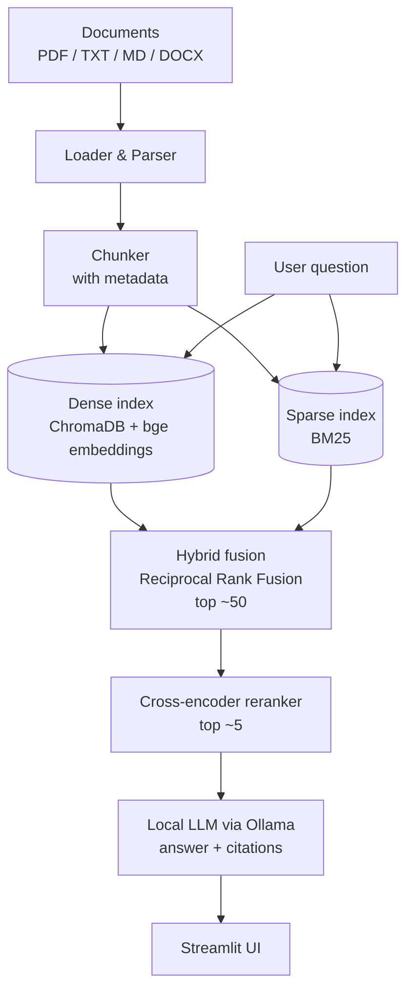

# Hybrid RAG via Reranking

A fully local, free-to-run **Retrieval-Augmented Generation (RAG)** system that combines **dense (semantic) search** and **sparse (BM25 keyword) search**, fuses the results with **Reciprocal Rank Fusion**, refines them with a **cross-encoder reranker**, and generates grounded, cited answers with a **local LLM via Ollama**.

It comes with a **Streamlit UI** that shows each step of the pipeline, and an **evaluation harness** that measures how much each stage contributes.

> **Status:** 🚧 Work in progress. See the [Roadmap](#roadmap) for what is implemented so far.

---

## Why hybrid + reranking?

| Approach | Good at | Weak at |
|---|---|---|
| **Dense search** (embeddings) | Matching *meaning*: "fix a flat tire" ≈ "repair a punctured wheel" | Exact terms, IDs, codes, rare names |
| **Sparse search** (BM25) | Exact keywords: `Error 0x80070005`, `Section 4.2` | Synonyms and paraphrases |
| **Hybrid (RRF)** | Combines the strengths of both | Its ranking is still approximate |
| **+ Cross-encoder reranker** | Reads the query and each passage together for precise relevance scoring | Too slow to run on the whole corpus, so it only scores the shortlist |

Retrieval stays fast because the cheap retrievers cast a wide net (~50 candidates), and answers stay accurate because the expensive reranker only scores that shortlist to pick the best ~5.

---

## Architecture



### Pipeline stages

1. **Ingestion**: Load documents, split them into overlapping chunks, and attach metadata (source file, page, chunk id).
2. **Indexing**: Embed chunks into a ChromaDB vector store and build a BM25 keyword index over the same chunks.
3. **Hybrid retrieval**: Query both indexes and merge the results with Reciprocal Rank Fusion:

   $$\text{RRF}(d) = \sum_{r \in \text{retrievers}} \frac{1}{k + \text{rank}_r(d)}, \quad k = 60$$

4. **Reranking**: Score each (question, chunk) pair with a cross-encoder and keep the top results.
5. **Generation**: Prompt the local LLM to answer **only** from the reranked context and cite its sources.

---

## Tech stack (100% free & local)

| Component | Choice | Role |
|---|---|---|
| Embeddings | [`BAAI/bge-small-en-v1.5`](https://huggingface.co/BAAI/bge-small-en-v1.5) via `sentence-transformers` | Turns text into meaning vectors |
| Vector store | [ChromaDB](https://www.trychroma.com/) (persistent, on disk) | Stores and searches embeddings |
| Keyword search | [`rank_bm25`](https://github.com/dorianbrown/rank_bm25) | Classic BM25 lexical retrieval |
| Fusion | Reciprocal Rank Fusion | Merges the dense and sparse rankings |
| Reranker | [`BAAI/bge-reranker-base`](https://huggingface.co/BAAI/bge-reranker-base) cross-encoder | Precise relevance scoring |
| LLM | [Ollama](https://ollama.com/) (default `qwen2.5:7b`) | Writes the final answer |
| UI | [Streamlit](https://streamlit.io/) | Chat interface with pipeline inspection |
| Evaluation | [BEIR](https://github.com/beir-cellar/beir) benchmark (default: SciFact) | Measures retrieval quality |

---

## Project structure (planned)

```
Hybrid_Rag_via_reranking/
├── src/hybrid_rag/
│   ├── config.py            # Central settings (models, top-k, paths)
│   ├── ingestion/           # Document loaders and chunking
│   ├── indexing/            # Dense (ChromaDB) and sparse (BM25) indexes
│   ├── retrieval/           # Hybrid retrieval + RRF fusion
│   ├── reranking/           # Cross-encoder reranker
│   ├── generation/          # Ollama client and prompt templates
│   └── pipeline.py          # End-to-end RAG pipeline
├── app/
│   └── streamlit_app.py     # Streamlit UI
├── eval/                    # Benchmark loading, metrics, experiment runner
├── scripts/                 # CLI helpers (e.g. ingest documents)
├── tests/                   # Unit tests
├── data/                    # Your documents and indexes (git-ignored)
├── requirements.txt
└── README.md
```

---

## Getting started

### Prerequisites

- **Python 3.11+**
- **[Ollama](https://ollama.com/download)** installed and running
- About 8 GB of RAM (16 GB recommended) and about 6 GB of free disk space for models

### Installation

```bash
# 1. Clone the repository
git clone git@github.com:Drag375o/Hybrid_Rag_via_reranking.git
cd Hybrid_Rag_via_reranking

# 2. Create and activate a virtual environment
python -m venv .venv
# Windows (PowerShell)
.venv\Scripts\Activate.ps1
# macOS / Linux
source .venv/bin/activate

# 3. Install dependencies
pip install -r requirements.txt

# 4. Pull the local LLM
ollama pull qwen2.5:7b

# 5. (Optional) Override default settings
cp .env.example .env

# 6. Check that everything is installed correctly
pytest
```

The embedding and reranker models download automatically from Hugging Face on first run. Every setting (models, chunk size, top-k values) is defined in `src/hybrid_rag/config.py` and can be overridden with a `RAG_`-prefixed environment variable or in `.env`.

### Usage

```bash
# Preview how your documents are loaded and chunked (put them in data/docs/ first)
python -m hybrid_rag.ingestion --show 3

# Build the dense (ChromaDB) and BM25 indexes from data/docs
# (re-run after adding or changing documents; it rebuilds from scratch)
python -m scripts.ingest
```

> The commands below will work once the corresponding roadmap items are complete.

```bash
# Launch the chat UI
streamlit run app/streamlit_app.py

# Run the retrieval benchmark
python -m eval.run_eval --dataset scifact
```

---

## Evaluation

The evaluation harness compares four retrieval setups on the same benchmark so the contribution of each stage is measurable:

| Setup | Description |
|---|---|
| Dense only | Embedding search |
| BM25 only | Keyword search |
| Hybrid | Dense + BM25 fused with RRF |
| **Hybrid + Rerank** | Hybrid, then the cross-encoder reranker |

**Metrics:** Recall@k, MRR@10, and nDCG@10.

Results will be published here once the harness is complete.

---

## Roadmap

- [x] Project plan and README
- [x] Project scaffold (config, dependencies, `.gitignore`)
- [x] Document ingestion and chunking
- [x] Dense index (ChromaDB + bge embeddings)
- [x] Sparse index (BM25)
- [ ] Hybrid retrieval with Reciprocal Rank Fusion
- [ ] Cross-encoder reranking
- [ ] Answer generation with Ollama and citations
- [ ] Streamlit UI with pipeline inspection
- [ ] Evaluation harness on a BEIR benchmark
- [ ] Results and analysis
